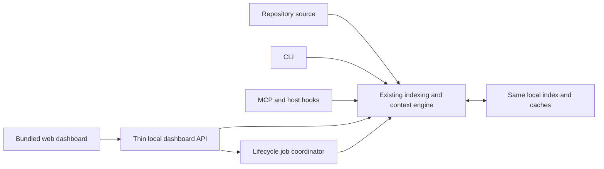

# PRISM dashboard integration — product requirements

**Version:** 1.0 · **Date:** 10 October 2026 · **Status:** proposed, ready for implementation planning

**Product:** a professional local web workspace for inspecting, operating and demonstrating PRISM.
**Primary audience:** developers and college project judges.
**Central requirement:** CLI, MCP and hooks retain their existing capabilities and efficiency. The dashboard is another interface to the same engine.

## 1. Product decision

PRISM can work through both CLI and dashboard. Build the dashboard around the existing Python library, local HTTP server and bundled TypeScript viewer. Keep source indexing, graph creation, context compilation, budgets, consent and freshness in the existing core.

The dashboard explains and exposes the engine; it does not replace it. Closing the browser must leave command-line navigation and host-agent integrations usable. Installing PRISM must not require a browser, an account, Node.js or an internet connection.

The first release runs on localhost. A future hosted project website can explain PRISM and publish selected reports. A hosted page cannot directly access a visitor's local repository; connecting it would require a separately designed, explicitly authorized local bridge. That bridge is outside this release.

### Plain-language workflow

**Today:** enable project → scan code → save facts under `.aicontext/` → agent requests relevant context → agent edits and verifies → PRISM refreshes changed facts.

**With dashboard:** open selected project → click an explicit indexing action → inspect the same facts and graph → enter a task to preview the same context engine → copy context or use the existing agent integration → inspect recorded results.

The agent remains responsible for edits and tests. A context preview is not an autonomous coding run.

## 2. Existing foundation and proposed additions

Baseline inspected: repository commit `088d198`, pulled on 10 October 2026.

| Capability | Existing foundation | Dashboard addition |
|---|---|---|
| Local index | Lifecycle scan/update, portable JSON and SQLite caches | Explicit controls, stage status and index inventory |
| Context engine | Task compilation, budgets, freshness and session reuse | Request form and evidence inspector |
| Graph | Existing viewer, filters, nodes, paths, impact and saved views | Integrate into the application shell; preserve its features |
| Agent integrations | CLI, MCP, host hooks and integration instructions | Setup status and supported handoff instructions |
| History | Existing local activity/worklog facilities | Paginated inspection when enabled |
| Benchmarks | Report artifacts and recorded usage where available | Validated report import and transparent comparison views |
| HTTP transport | Token-protected localhost server, SSE | Thin endpoints for status, context and explicit lifecycle jobs |

The new endpoints, job management, report schema adapter and dashboard screens below are requirements, not claims that these features already exist.

## 3. Goals, scope and success criteria

### Goals

1. A judge can understand PRISM's role within one minute.
2. A developer can inspect index health and retrieve task context without learning commands.
3. A developer using only CLI/MCP experiences equivalent retrieval results and budgets.
4. The UI distinguishes recorded model usage, estimates, missing evidence and failed runs.
5. The product feels like a precise developer workstation: clear hierarchy, original visuals and restrained motion.

### First-release scope

- Local project overview, index lifecycle controls, graph workspace, context workbench, benchmark report viewer, integrations/settings and a guided demonstration.
- Dark, light and system themes across every screen and interaction state.
- Complete loading, empty, stale, paused, unauthorized, disconnected and error states.
- Export the final context packet and benchmark report; preserve provenance and estimates.
- Desktop-first interaction with responsive access to forms, reports and graph alternatives.

### Later scope

- Multiple approved local projects in one server, authenticated agent execution adapters, live paired benchmark orchestration, a public project website and team collaboration.
- A benchmark-run button is enabled only when a real runner can isolate agents, capture usage and enforce matching settings. Report import works first.

### Explicit exclusions

Cloud repository uploads, sign-in, billing, a chat model inside PRISM, general terminal execution, automatic source editing and fabricated token-saving counters.

### Release gates

| Gate | Acceptance condition |
|---|---|
| Core compatibility | Existing CLI/MCP/hook tests pass; public arguments and outputs retain compatibility |
| Retrieval parity | Fresh CLI and dashboard requests produce equivalent semantic packets at the same revision, mode and budget |
| Delivery accounting | UI previews cannot consume an agent's delivered-source memory |
| Offline operation | Built package serves assets, fonts, graph and retrieval without network requests |
| Honest reporting | Missing, interrupted or incompatible runs never produce a success percentage |
| Presentation | A clean first-time visitor can complete the documented demo in 3–5 minutes |
| Accessibility | Keyboard, contrast, focus and non-canvas alternatives verified against WCAG 2.2 AA |

## 4. Personas and primary journeys

**Developer:** opens a repository, checks freshness, requests context, inspects source and hands the final packet to an existing agent.

**Judge:** sees the problem, a real index, the selected code, a working graph and a measured paired result with correctness evidence.

**CLI-first user:** continues using commands; optionally opens the dashboard for graph exploration and reports. There is no mandatory UI registration or setup step.

### First project and indexing

1. Start `prism view --root <project>` using the existing entry point.
2. Exchange the launch token for the existing protected cookie and remove it from the URL.
3. Display the bound repository name, path, branch/revision and consent state.
4. If uninitialized, show the proposed file/integration changes before the user chooses **Enable and build index**. Selecting a path or opening a page alone does not enable anything.
5. Run lifecycle work as a background job and show real stages and counts.
6. Show completed facts or partial failure with diagnostics. No invented completion percentage.

First release binds one approved root per server. Switching to another repository uses an explicit launch/open flow. A browser folder upload is not equivalent to opening a repository on disk; do not imply that a standard folder picker supplies a trusted absolute path.

### Task context and handoff

1. Enter a request, choose context mode and budget, then click **Retrieve context**.
2. Show the final packet, confidence, sufficiency, source revision, omitted ranges and estimates.
3. Inspect code, callers, tests and relationships without silently expanding the model packet.
4. **Copy context** or download the exact final packet. Show a preview of what will be copied.
5. For an existing agent integration, provide the appropriate CLI/MCP instructions. Do not assume a clipboard copy automatically entered an agent's conversation.
6. Show targeted next steps for incomplete evidence. Permit refinements and an explicit budget increase.

### Changes and refresh

A source change marks affected views stale. Explicit refresh and existing permitted query-time refresh use the same lifecycle implementation and lock. Publish a completed new index revision to the UI; never present mixed-revision facts as one coherent graph.

### Judge demonstration

Open the overview → build or inspect the real index → explore one call relationship → enter a change request → inspect source and confidence → open a completed paired benchmark → show both correctness and actual usage.

If the agent provider is unavailable, the live retrieval demonstration remains usable. Label saved benchmarks with their run dates. Prepared demo data is visibly identified and is never substituted for live project facts.

## 5. Information architecture and screen specification

### Global application shell

Left navigation: **Overview**, **Context**, **Graph**, **Benchmarks**, **Integrations**. Settings and help sit at the bottom. The top bar contains project identity, branch, freshness, a command/search entry and theme control. An unobtrusive job indicator links to active operations.

Use clear page titles and a one-line purpose statement. Commands offered for convenience have an explicit copy button. Toasts acknowledge actions; persistent errors and warnings remain visible in their relevant panel.

### A. Overview

- Main header: repository name and source revision, with **Retrieve context**, **Open graph** and **Refresh index** actions.
- Summary strip: indexed files, symbols, languages, unresolved/partial parsing and last completed index time. Counts come from the manifest, not a simulated counter.
- Primary visual: a live, bounded graph preview, paired with an index-health panel.
- Lower sections: language breakdown, changed files, recent local activity and integration status.
- Benchmark teaser appears only when validated results exist; otherwise explain how to import a report.
- Uninitialized state has a diagram of the scan process and an explicit setup action. Do not show zero counts as if a successful scan occurred.

### B. Context workbench

Desktop layout: request form above a two-column evidence workspace. Left column contains ranked source blocks; right column contains context summary, related tests/callers, impact and missing evidence. Columns collapse into tabs on small screens.

Form controls: multi-line task input, **Auto / Code / Overview** mode, engine-supported budget presets, explicit maximum, **Retrieve context** button and optional advanced session controls. Long requests are not silently truncated in the form.

Each source block shows rank, repository-relative path, symbol, line range, source revision, complete/partial state and highlighted verbatim code. Clickable connections open inspectors without replacing the request. A reference to source previously delivered is explicitly marked and can be expanded on demand.

Summary distinguishes **confidence**, **sufficient evidence**, and **estimated packet tokens**. Show the engine's explanation and next steps; confidence is not rendered as an unsupported numeric probability. Use one clearly labeled visualization of budget allocation when the packet provides reliable components; otherwise show the total only.

Two representations are available: **Readable** and **Structured JSON**. Only the chosen final packet is copied. Syntax highlighting, UI labels, image assets and expanded inspection content are not injected into agent context.

States: first use, retrieving, no match, weak candidate, partial evidence, stale source, paused project, conflicting update, invalid budget, expired session and server disconnected. Failure preserves the request for retry.

### C. Graph workspace

Reuse existing package/file/symbol levels, import/call filters, search, focus, paths, impact, risk/health overlays, saved views and inspector. Preserve confidence labels for approximate static relationships.

The canvas occupies the primary area. A collapsible node list sits left; selected-node details sit right. Use restrained labels, a compact legend and deliberate spacing. Fit-to-view and zoom are visible. Graph layout is stable on theme changes and ordinary panel interactions.

Provide an accessible relationships table and keyboard-selectable node list. Canvas imagery must never be the sole representation of important graph facts.

### D. Benchmarks

Campaign header: repository commit, PRISM version, model, reasoning setting, date, tasks/repetitions, measurement method and run status.

Primary comparison is a readable table: with/without input, cached input, uncached input, output, total, tool calls, time and correctness. A small paired bar chart complements the table. Treat negative savings as a valid result; both directions are visible.

Separate sections: index construction cost, first-use cost, already-built-index task cost, context estimates, failed runs and per-task details. Provide links to local usage evidence with redacted export. Filters must state whether excluded failures change the population.

Import flow validates the selected report and schema. Unknown values show **Unavailable**; incompatible pairs show **Not comparable**. An incomplete pair never shows a green savings badge.

### E. Integrations and settings

Cards show actual configuration status for supported host agents. Installation actions display the exact changes before applying them through existing integration code. A configured integration is not labeled connected unless a real connection can be verified.

Settings: theme, graph display, context defaults, activity history preference and existing supported consent/pause controls. Changing visual settings does not rewrite core budget or integration defaults silently. Provide a reset-to-defaults action for UI preferences.

### F. Presentation/help screen

An optional local **About PRISM** view explains the problem, pipeline and constraints using a product screenshot and a small original schematic. Copy: **“Relevant code context, before your agent edits.”**

Explain that PRISM compiles local evidence and the user's host agent reasons about it. Avoid claims such as “understands every repository” or “guaranteed 90% savings.”

## 6. Visual direction and design system

### Art direction

Aim for an engineering instrument with editorial clarity: warm paper in light mode, deep graphite in dark mode, cobalt actions, generous spacing and real source/graph imagery. Use distinctive typography and composition rather than oversized slogans and interchangeable feature cards.

The identity is a precise prism mark with a narrow spectral detail. Reserve color for actions, graph categories and status. Avoid purple gradient heroes, glowing robot art, glass panels on every surface, fake customer logos, stock handshake photos and decorative charts presenting invented data.

### Theme tokens

All colors are semantic CSS variables. These are initial design values; verify contrast for every actual foreground/background pairing before shipping.

| Token | Light | Dark | Use |
|---|---|---|---|
| Background | `#F5F6F8` | `#101318` | Application canvas |
| Surface | `#FFFFFF` | `#181D25` | Panels and controls |
| Raised surface | `#EBEEF3` | `#222A35` | Menus, selected context and hover surfaces |
| Primary text | `#182230` | `#F1F4F9` | Headings and body |
| Secondary text | `#566273` | `#B1BDCF` | Metadata; still readable |
| Decorative border | `#D8DEE7` | `#364254` | Panel separators |
| Interactive outline | `#718096` | `#75849B` | Controls requiring visible boundaries |
| Action/focus | `#155EEF` | `#8CB5FF` | Buttons, links and focus indicator |
| On action | `#FFFFFF` | `#101318` | Text on filled action buttons |
| Success | `#137647` | `#76D6A4` | Verified completion |
| Warning | `#8A4B00` | `#F3C16B` | Partial/stale evidence |
| Error | `#B42335` | `#FF9CA9` | Failures and unavailable operations |

Graph categories use a distinct palette with a textual legend and shape/line differentiation. Node categories are not confused with success/error states. Charts identify both arms using labels and stroke/pattern as well as color.

### Typography and layout

- Retain the existing locally bundled Bricolage Grotesque for concise display headings and JetBrains Mono for source and technical identifiers. Use a readable local/system sans stack for paragraphs and controls.
- Suggested hierarchy: page title 28–32 px, section title 18–20 px, body 15–16 px, metadata 12–13 px, code 13–14 px. Use tabular numerals for metrics.
- Base spacing: 4/8/12/16/24/32/48 px. Panel radius 10–12 px; button radius 6–8 px. Use minimal shadows in light mode and clear surface separation in dark mode.
- Desktop sidebar 224 px, top bar 64 px, standard content padding 24–32 px. Reports/forms have a readable maximum width around 1,240 px; the graph can use the full workspace.
- Above 1,200 px use split panels. At 768–1,199 px collapse the secondary panel. Below 768 px use a navigation drawer and stacked forms; relationship tables remain usable without dragging the graph.

### Imagery and asset requirements

| Asset | Placement | Content and implementation |
|---|---|---|
| Product screenshot | About/demo and future public landing | Capture the real completed UI; label sample data; provide light and dark variants |
| Original prism artwork | About header and uninitialized state | Custom vector illustration or one commissioned/rendered optical prism image; compact spectral detail, no generated text |
| Pipeline schematic | Help and setup | Accessible SVG/HTML explaining source → index → context → agent; accompany with equivalent text |
| Graph preview | Overview | Real repository data or a visibly labeled sample; no unrelated stock network image |
| Empty-state illustrations | Empty context/reports/history | Small original line illustrations matching the icon stroke and palette |

Every asset has a documented author/license and appropriate alt text; decorative images have empty alt text. Ship assets locally. Use SVG for diagrams/icons and WebP/AVIF with fallback for photographs. Supply sensible dimensions and lazy-load below-fold imagery. No remote image/font requests are required for the demo.

Decorative imagery stays out of dense source, graph-inspector and benchmark work areas. Professional visual quality comes from alignment, information hierarchy, accurate content and interaction states.

### Interaction and accessibility

Theme defaults to system and persists the user's explicit selection locally. Set it before first paint; changing it does not rescan or rerun context retrieval. Cover editors, charts, menus, graph controls and error states in both themes.

Use 120–180 ms transitions for controls and 180–240 ms panel transitions. Respect reduced motion; graph entry effects are optional and must not block access. Existing long intro effects should be shortened or skipped for returning users.

Target [WCAG 2.2 AA](https://www.w3.org/TR/WCAG22/): readable contrast, keyboard operation, visible unobscured focus, labeled controls, accessible names and error messages. Meet minimum target sizing and use approximately 44 px primary touch controls where practical. Announce completed jobs without stealing focus. At 200% zoom, forms and reports reflow; graph information remains accessible in the list/table alternative.

## 7. Technical integration and compatibility contracts

### Shared core, separate presentation



Evolve `viewer/` and `prism/viewer/` rather than creating a second core or replacing the current viewer. Continue bundling built assets under `prism/viewer_dist/`; end users need Python and the installed package, not a Node development server. Avoid adding a large server framework solely for dashboard routing.

Define a typed application/service boundary around existing lifecycle, consent and navigator operations. The HTTP adapter validates parameters and serializes results. It must not recreate ranking, source-window fitting, freshness or graph algorithms in TypeScript, nor invoke interpolated shell commands.

Use existing authenticated endpoints for graph operations. Proposed first-release additions:

| Proposed route | Purpose | Semantics |
|---|---|---|
| `GET /api/project/status` | Bound root, consent, freshness and manifest revision | Inspect only; no implicit initialization |
| `POST /api/context/preview` | Request, mode, budget and optional UI session | Same task engine; permitted refresh disclosed; no agent delivery acknowledgement |
| `POST /api/context/export` | Exact final packet and explicit delivery intent | Validate revision; do not assume host receipt |
| `POST /api/index/plan` | Prepare first-time lifecycle/integration changes | User-approved, bound root; return visible plan |
| `POST /api/index/jobs` | Execute approved initialization, scan or update | Explicit action, valid plan/consent and existing write lock |
| `GET /api/jobs/{id}` | Real stages, counts, timestamps and error state | Repository-bound status |
| Existing SSE transport | Completed revisions and job events | Typed, throttled, lightweight events |
| `POST /api/benchmarks/import` | Validate user-selected report data | Bounded JSON; no imported commands are executed |
| `GET /api/benchmarks/{id}` | Normalized results and provenance | Read-only presentation |

Route names may be finalized during design review. Existing `/api/graph`, node, search, path, impact, diff, layouts and views stay compatible. Deeper application links must resolve to the bundled shell, with API and static-asset failures retaining their correct status codes.

### Critical session rule

Browsing a source block is not delivery to the agent. UI preview sessions use a distinct namespace and do not update a CLI/MCP/host-agent session's seen ranges. By default previews are complete fresh responses with no delivery side effects.

If a future adapter sends context directly to an agent, update delivery memory only for the exact packet acknowledged by that host. An exported/copy packet may update a separate explicit export record, but never silently marks the agent's conversation as having seen it. Preserve existing hash invalidation and cross-surface reuse for actual agent sessions.

### Budgets and updates

- Visual expansion retrieves human inspection content outside the model packet. It cannot enlarge the final exported packet silently.
- Keep engine mode defaults, hard caps, confidence and missing-range guidance. Expose supported controls; do not invent larger caps for the UI.
- Cache human graph payloads separately from model packets. A new theme/layout/filter does not rebuild the index.
- Use the existing cross-process update lock. Duplicate update requests coalesce or show the active job; HTTP request threads do not hold long scans.
- Cancellation occurs at safe lifecycle boundaries. If interruption cannot safely stop a scan, say so and let it finish; never publish a partial manifest as completed.
- Dashboard metadata refresh is event-driven with modest reconnect backoff. Avoid repeated task requests or full-source polling while idle.
- Core CLI/MCP imports must not require web assets or start the HTTP server. No outbound model calls are added to PRISM.

## 8. Local privacy and lifecycle controls

Keep loopback binding, launch-token authentication and existing host/origin protections. Mutating requests require the current authorized session, repository binding, validated JSON and appropriate consent. Request limits and source path containment apply after path resolution, including symlink/junction cases.

Never expose an arbitrary command runner or accept an unrestricted filesystem root from browser requests. Return repository-relative paths for source panels. Persist UI state and job/report records in bounded gitignored local storage, not tracked portable knowledge artifacts.

The launch token should be exchanged for the existing HttpOnly/SameSite cookie and removed from the address bar. Redact tokens, credentials and machine-specific private paths from exported reports. An expired launch/session screen explains **“Open PRISM from your terminal to reconnect”** and supplies the safe command without exposing a secret.

A bound-root bootstrap screen for an uninitialized project may require extending current viewer startup. It must be able to inspect state without creating an index. Show the exact init/integration plan and require an explicit action before applying it. Paused/not-enabled states remain governed by existing per-user consent semantics.

UI source content and repository text are untrusted display data: render them escaped, never execute them as HTML or dashboard instructions. Imported benchmark reports are data, not scripts.

## 9. Benchmark truth and measurements

The dashboard must support the project's central claim with evidence. A source-size reduction is not an actual agent-token reduction. Cached computation is not automatically remote-token savings.

Each pair records: repository and PRISM commits, task, model/reasoning, agent configuration, repetition/seed where applicable, index state, timestamps, completion state, transcript/usage provenance, correctness checks and the timing boundary used.

Required usage fields: input, cached input, output, total and provider-supported cache-write/reasoning fields. Preserve provider definitions; reasoning can already be included in output. Do not count it twice. Missing fields remain null.

Calculations:

```text
uncached_input = input - cached_input
raw_total = input + output
metric_saving_pct = 100 * (without - with) / without
```

Only calculate when both measurements are available, the denominator is positive, the runs are comparable and correctness qualifies them. Document cache-write accounting per provider rather than applying one formula to every provider.

A cost estimate uses recorded usage and explicit model prices, currency and effective date. Any configurable weighted-token proxy is named **Proxy**, displays its weights and is never labeled a bill or universal pricing rule. Do not use a hardcoded cached-input discount as a measured cost.

Report separately: deterministic index build time/LLM cost; retrieval packet estimates; actual complete agent usage; setup/orchestrator usage where captured; test success; and overhead attributable to a dashboard-assisted handoff. Charts include confidence/sample limitations and expose individual repetitions.

One-run results are labeled pilots. For reproducible evaluation, repeat matched tasks in fresh sessions, randomize order and preserve failures. Without-PRISM agents may search efficiently; never force full-repository reads to inflate the saving.

Amortized views declare assumptions. For time: first-use index cost plus observed task cost; for N tasks: setup cost/N plus observed comparable task cost. An observed per-task average is not a prediction that every future task has the same cost. Offline indexing normally has zero LLM tokens but still costs time and compute.

## 10. Nonfunctional targets and validation

These are proposed engineering targets, not current measured claims. Establish a pre-dashboard baseline on the same hardware, repository snapshots and software settings before acceptance.

| Area | Target / method |
|---|---|
| Semantic parity | Equivalent core results and budgets for fresh CLI/MCP/dashboard requests; ignore only presentation metadata |
| CLI isolation | Dashboard closed: no extra web startup, model calls or web dependency requirements |
| Concurrent overhead | Across at least 30 matched warmed retrievals, dashboard idle causes no more than 5% median and 10% p95 latency increase; publish noise and hardware |
| CLI token behavior | Identical model packet size for equivalent inputs; browser events never inject extra agent context |
| First useful UI | Target under 2 seconds locally with a ready index and cached assets; bootstrap must not wait for graph layout |
| Forms and controls | Target response under 100 ms for ordinary local interactions; network/engine work has explicit progress states |
| Graph scale | Preserve existing graph-performance baselines; test 1k/10k nodes, scope larger graphs and lazy-load the renderer |
| Updates | Refresh changed facts once, retain consistent revisions and show lock contention without blocking the UI |
| Idle behavior | No unsolicited model requests or index scans; timers/SSE retry loops stop appropriately on navigation/disconnect |

Test suites must cover:

1. Existing core regressions and CLI/MCP/hook compatibility, including the dashboard never being started.
2. API validation, root confinement, consent, auth/cookie handoff, oversized bodies and escaped repository text.
3. Shared task parity, budget caps, stale sources and source-hash invalidation.
4. UI preview/export followed by an actual agent request: original source must still be available to that agent.
5. Concurrent dashboard inspection, context requests and CLI updates; cancellation/failure must preserve valid artifacts.
6. Broken/absent UI assets: CLI continues working; viewer shows actionable failure.
7. Benchmark imports with missing counters, double-counted reasoning, invalid denominators, incompatible commits and rate-limited runs.
8. Keyboard-only journeys, light/dark/system preference, zoom/reflow, reduced motion and representative screenshot review.
9. Package build/install with bundled assets and disconnected-network operation.

## 11. Delivery plan and definition of done

### Phase 1 — preserve the core

Capture compatibility/performance baselines. Define the service boundary and schemas. Implement project status and context preview with session isolation. Add parity and consent tests before styling or lifecycle write controls.

### Phase 2 — complete visual foundation

Build the shared shell, themes, typography, components and all states. Integrate the current graph without removing features. Deliver original assets and light/dark screenshot specifications. Verify routing and packaging.

### Phase 3 — useful project operations

Implement Overview, Context, authorized lifecycle jobs and job events. Add integration status and existing setup-plan actions. Validate concurrent CLI use and the offline demo.

### Phase 4 — credible evidence and judging polish

Implement validated benchmark import, comparisons, exports and guided demo. Audit accessibility and runtime overhead. Publish limitations and measured parity results.

Future direct agent execution is a separate milestone after provider usage capture, isolated workspaces, cancellation and user-approved operation scopes are defined. Do not ship a simulated run button.

### Final acceptance checklist

- CLI, MCP and hooks work independently with all existing capabilities and default budgets.
- Dashboard and CLI use the same index and compilation implementation.
- Dark/light/system themes are complete, readable and persistent without source/index side effects.
- Visual design uses actual code/graph evidence and original, licensed imagery.
- Local setup, authentication, consent, refresh and reconnect flows are usable.
- Confidence, partial evidence and measurements are represented faithfully.
- Graph features and accessible alternatives remain available.
- Benchmark percentages require comparable completed runs and verified correctness.
- Packaged dashboard runs locally without Node, external assets or an account.
- The 3–5 minute judge demo is rehearsed with an offline fallback and dated recorded reports.

## 12. Implementation references

- [Architecture](architecture.md), [persistent context engine](context-engine.md), [graph viewer](viewer.md), and [product specification](../CLAUDE.md).
- Current backend: `prism/viewer/server.py`, `prism/viewer/api.py`, `prism/lifecycle.py`, `prism/navigator/api.py` and existing consent/freshness/session implementations.
- Current frontend: `viewer/src/` and `viewer/package.json`; packaged output: `prism/viewer_dist/`.
- [W3C WCAG 2.2](https://www.w3.org/TR/WCAG22/) for accessibility acceptance.

This PRD establishes product and acceptance requirements. It does not certify implementation completion, benchmark savings or enterprise readiness.
